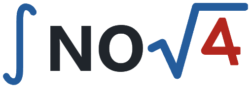
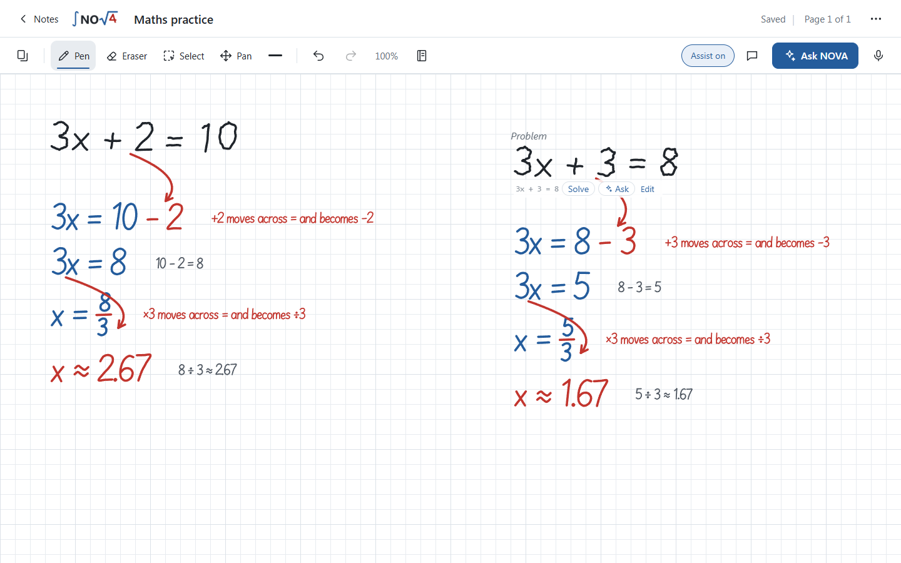
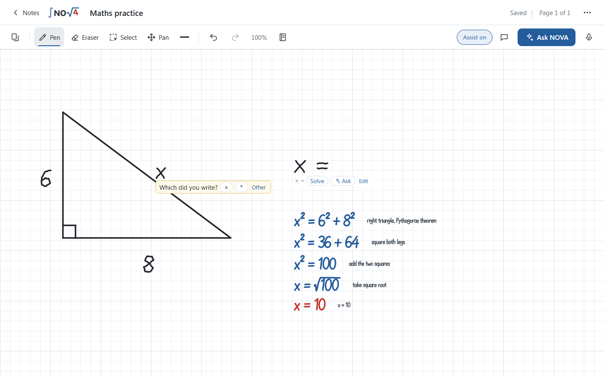
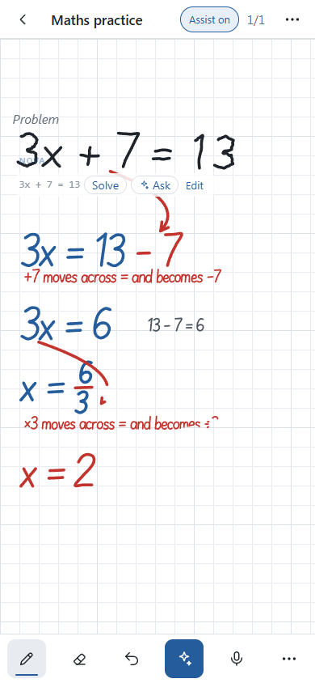

<p align="center">
  
</p>

<h3 align="center">A maths notebook that reads your handwriting and teaches you, step by step.</h3>

<p align="center">
  <a href="https://nova-roan-eta.vercel.app"><b>▶ Try it live</b></a> ·
  <a href="BharatCode.txt">How BharatCode powers it</a> ·
  <a href="#run-it-on-your-pc">Run it on your PC</a>
</p>

---

Write maths on an endless grid page with your finger, stylus or mouse — exactly like a paper notebook.
NOVA reads it, checks it, and answers **right next to it, in handwriting**. No typing, no forms.

<p align="center"></p>

## What NOVA does

| You write | NOVA writes |
|---|---|
| `4 + 2 =` | **6** beside the `=` |
| `3x + 2 = 11` | every step, with **red arrows** showing what moved across `=` and *why* — made for beginners |
| `4 + 2 = 7` | a red ✗ (and a ✓ when you're right) |
| `y = 2x + 1` | the graph |
| `f(x) = 3x² + 5x + 7`, `f′(2) = ?` | f′(x) = 6x + 5 → … → **f′(2) = 17** |
| `3 + 4 + … + 100` | **5047**, with the AP formula |
| `A ∪ B`, limits, integrals, logs, trig, probability | worked solutions |
| `[1 2; 3 4] × [5 6; 7 8]`, `det`, inverse, `a · b`, `a × b` | vectors & matrices, step by step |
| `sin x + tan x = 30` | solved numerically: x ≈ 1.536 + 2nπ, x ≈ 4.680 + 2nπ |
| a **hand-drawn triangle** labelled 6 and 8, then `x =` | reads the diagram → **x = 10** (Pythagoras) |

<p align="center">
  
  &nbsp;
  
</p>

**Also:** an *Ask NOVA* chat (type or speak — spoken questions are answered aloud), tables and formulas written onto your page,
PDF question papers where NOVA is a study friend during the test and marks it at the end, a "teach NOVA your handwriting" screen,
and it works on phones, tablets and laptops.

## How it's built

- **BharatCode** (`qwen-3.8-27b`) is NOVA's eyes and its professor: it reads every handwritten line (twice, and asks
  *"Which did you write?"* when the two reads disagree, instead of marking a misread as your mistake), reads geometry
  diagrams, and writes beginner-friendly solutions for anything beyond the exact engine. Details in [`BharatCode.txt`](BharatCode.txt).
- **Exact maths stays exact:** arithmetic and equations are solved by NOVA's own engine (fractions + SymPy) and verified.
- **Web:** React 19 + TypeScript + Vite, canvas ink, and a handwriting engine that writes answers in a human hand.
- **Server:** Python FastAPI (Vercel, Mumbai region). The API key never reaches the browser.
- **Privacy:** notebooks stay on your own device.

## Run it on your PC

You need Python 3.11+, Node 20+ and a [BharatCode](https://bharatcode.ai) API key.

```sh
# 1) server
cd server
python -m venv .venv
.venv/Scripts/python -m pip install -r requirements.lock        # macOS/Linux: .venv/bin/python
echo BHARATCODE_API_KEY=your_key_here > .env                     # stays on the server, never in the browser
.venv/Scripts/python -m uvicorn app.main:app --host 127.0.0.1 --port 8010

# 2) web (second terminal)
cd web
npm ci
npm run dev                                                      # open http://127.0.0.1:5180
```

Tests: `cd server && .venv/Scripts/python -m pytest -q` · `cd web && npx vitest run`

**Deploy your own:** import the repo on Vercel (the `vercel.json` is ready), add `BHARATCODE_API_KEY` in
Environment Variables, deploy. Optional: `NOVA_ACCESS_CODE` to require a code from testers.

## License

NOVA is open source under the **[GNU AGPL-3.0](LICENSE)** © 2026 Beyond The Prompts.
You're free to run it, learn from it and improve it. If you share a modified version, or run one as a website,
you must publish your source code under the same license and keep the credit. The **NOVA name and logo are not
licensed** for other projects. See [`NOTICE`](NOTICE).

---

<p align="center">Made by <b>Beyond The Prompts</b> · If NOVA helped you, please ⭐ the repo!</p>
